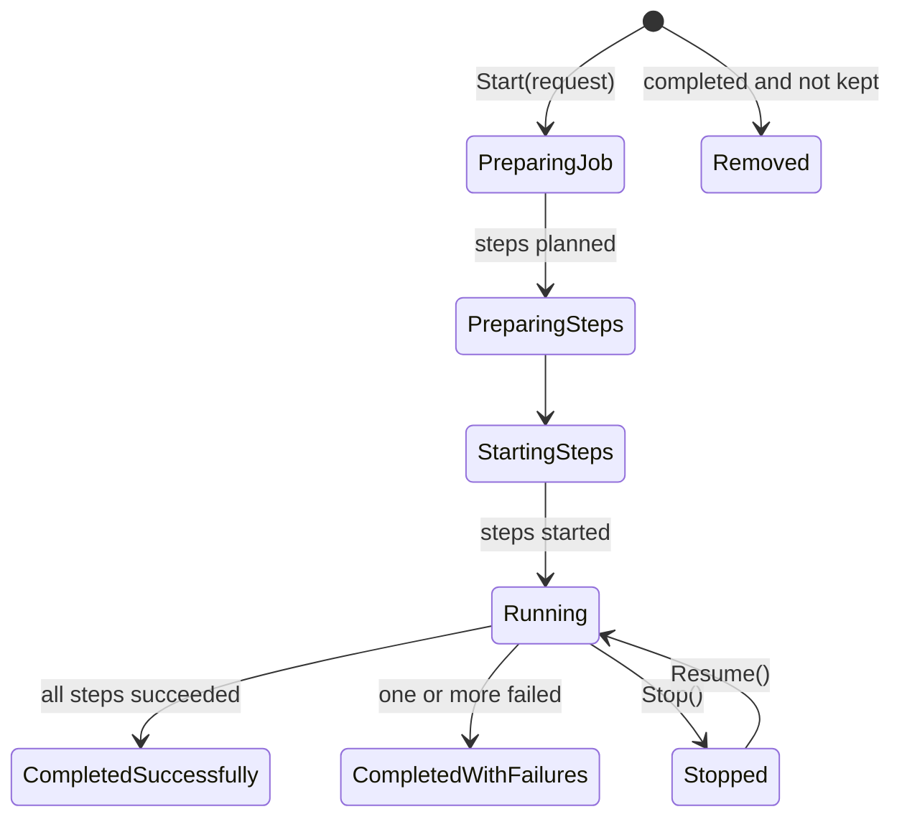

A **job** is work that outlives a request: a replay, a migration, a provisioning pass - anything that must
survive the process going away while it runs. A job **plans** what it will do, then performs the plan as
**steps**, each step its own Orleans grain.



## Planning is separate from performing

`PrepareSteps` says what a job will do before any of it happens. That is what lets somebody watch progress
rather than a spinner: the total is known up front, and each step reports its own outcome as it finishes.

## Steps are grains

Each step runs as an independent grain activation, so slow or hanging steps cannot stall each other or the
job's own bookkeeping, and steps run in parallel - bounded by the throttle. The step reports back to the job
grain; the job counts outcomes, never performs the work itself.

## A step may be performed twice

The grain counts a step only once it has finished with it, so a step that was in flight when the host went
down is performed again on resume. A performer must tolerate being asked twice; anything that must not happen
twice belongs behind a check the performer itself makes. Progress checkpoints are debounced (see
[Options](../reference/options.md)), so a crash between checkpoints re-delivers every batch handled since -
an at-least-once relaxation, not a free one.

## One failed step does not abandon the rest

A job that could not do one piece of work has still done the others, and the job's history says which was
which. A failed step fails the job's completion status - it never fails the application: the failure is
recorded state, not an exception on anybody's startup path.

## Stages order steps that depend on each other

Steps are independent by default, and that is the shape to prefer: every step starts at once and the throttle
decides how many run. Some jobs are pipelines instead, where a later step would do the wrong thing - not just
a slow thing - if it ran before an earlier one. Such a job puts its steps in **stages**:

```csharp
protected override Task<IImmutableList<JobStepDetails>> PrepareSteps(RecoveryRequest request) =>
    Task.FromResult<IImmutableList<JobStepDetails>>(
    [
        CreateStep<ISettleFinishedWork>(request, stage: 0),
        ..request.Abandoned.Select(work => CreateStep<IResumeAbandonedWork>(work, stage: 10)),
        ..request.Overrunning.Select(work => CreateStep<IStopOverrunningWork>(work, stage: 20)),
    ]);
```

- Every step in a stage reaches an outcome before any step in a later stage starts. Within a stage the steps run
  in parallel exactly as they do without stages. A job that never assigns one has every step in
  `JobStepStage.First`, which is a single stage and today's fan-out.
- Stages run in the order of their value; gaps are harmless, so numbering by tens leaves room to insert one.
- A stage is a **barrier** by default: if any of its steps fails, the job stops there. The steps in every later
  stage are recorded as `Unreachable`, count toward completion, and the job ends `CompletedWithFailures` rather
  than waiting forever for steps that will never run. Override `GetFailureBehaviorFor` to return
  `JobStageFailureBehavior.ContinueWithNextStage` for a stage that is best-effort.
- Every step is still prepared up front, so preparing a step in a later stage cannot observe what an earlier
  stage did. Read anything it needs from an earlier stage when the step is performed.
- `Start` returns once the first stage is running, and its errors describe that stage. Later stages report
  their start failures through the job.
- On resume the job picks up at the stage it had reached, and the stages behind it wait their turn.

## Jobs are placed where there is capacity

A job is a grain of its own type, so Orleans only considers silos that have that job's class loaded. A silo that does not host a particular job never receives it. Among the silos that do host it, jobs use resource-optimized placement: a new job activates on the silo with the most headroom for CPU, memory and activations, rather than on whichever silo happened to receive the request that started it. Scaling a service out therefore spreads job load instead of pinning it to the busiest replica.

## The job's state is its storage

What a job remembers - its status, its progress, its request - persists through the jobs storage (see
[Storage scopes](storage-scopes.md)), not through events. A completed job removes itself from storage by
default; override `KeepAfterCompleted` on the job to keep it queryable after it is done. A job that completes with
failures is kept by default so the failure stays readable. A job that runs on a short cadence would keep one record
per failed run for as long as the failure lasts, so it overrides `KeepAfterCompletedWithFailures` to let those go and
reports its failures some other way.

## Step state lasts only as long as the step needs it

Step state supports execution and recovery; it is not a durable place to keep a step's output or an inbox
for external callbacks. Its lifetime depends on the status written:

| Step status | What happens to its stored state |
| --- | --- |
| `CompletedSuccessfully` | Deleted |
| `Removing` (the job is being removed) | Deleted |
| `Failed` or `CompletedWithFailure` | Moved to failed-step storage |
| `Stopped` | Kept so the step can resume |
| `Scheduled` or `Running` | Saved for recovery |
| `Unreachable` (an earlier stage failed) | Saved until the job's state is cleared |

Failed-step storage is a separate collection in MongoDB and in memory; SQL retains the row with a failed
status. Clearing the job's state removes all its step rows, including failed steps. Keeping the job with
`KeepAfterCompleted` does **not** keep successfully completed step state.

A step hands its outcome to the job through `JobStepResult`, not through its stored state. On success,
`OnStepSucceeded` receives that result after the step's successful status write. The job's
`OnStepCompletedOrStopped` override receives results for successful, failed, and stopped steps; use it to
copy anything the job must retain into job state.

`PerformStep` receives a snapshot through the step's grain-reference `GetState()` call. That snapshot does
not see later writes to the step's state, and changing the snapshot does not persist those changes.

Since v1.16.2, the framework reports a prepared step stopped before or during its work to the job exactly
once. Deactivation without an explicit stop leaves scheduled work recoverable for resume instead of
reporting it as stopped. Do not add cancellation reporting in a job step's `PerformWork` override: the
framework already reports it, and reporting it again makes the job count the stop twice.

## Deliver outside input to the job, not its steps

An external worker may call your application back with progress or a result while a step is running.
Expose a method on the **job's own grain interface**, update job state in its implementation, and call
`WriteState()`. Override `KeepAfterCompleted` when those values must survive successful completion.

This excerpt adds a callback to an existing job. It assumes your serializable `WorkerProgress` type,
`WorkerRequest : IJobRequest`, and `WorkerJobState : JobState` with a writable `LatestProgress` property of
type `WorkerProgress`. The job's existing partial class supplies `PrepareSteps` and its other behavior;
this is not a standalone job implementation.

```csharp
using System.Threading.Tasks;
using Cratis.Monads;
using Cratis.Orleans.Jobs;

public interface IWorkerJob : IJob<WorkerRequest>
{
    Task<Catch> RecordProgress(WorkerProgress progress);
}

public partial class WorkerJob : Job<WorkerRequest, WorkerJobState>, IWorkerJob
{
    protected override bool KeepAfterCompleted => true;

    public Task<Catch> RecordProgress(WorkerProgress progress)
    {
        State.LatestProgress = progress;
        return WriteState();
    }
}
```

The callback handler calls `RecordProgress` through the job's grain reference. `WriteState()` returns a
`Catch`, so returning it preserves a persistence failure for the caller to handle rather than acknowledging
an input that was not saved. On success, the latest progress is stored with the job and survives its
successful completion. This does not update an already-running step's snapshot or wake the step; any
coordination with that work belongs in your job's design.

:::caution[Do not use step state as a callback inbox]
Adding step-grain methods that write `State` while `PerformStep` runs is not supported. Such a write can
race the step's final status write, and successful completion deletes the stored state. Keep incoming
values on the job instead.
:::

## Rehydration

When the silo starts, the jobs manager rehydrates every job that had not finished, and each resumes from its
persisted steps. Reminders play no part in this - which is why the hosting setup can keep reminders on the
in-memory service without costing the job system anything (see [Host the silo](../how-to/host-the-silo.md)).
