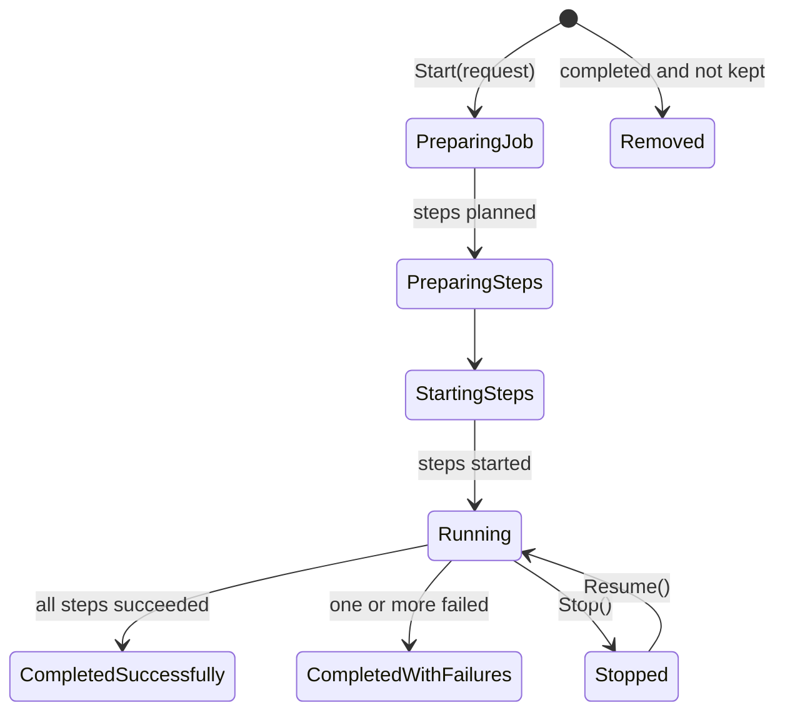

A **job** is work that outlives a request: a replay, a migration, a provisioning pass - anything that must
survive the process going away while it runs. A job **plans** what it will do, then performs the plan as
**steps**, each step its own Orleans grain.



## Planning is separate from performing

`PrepareSteps` says what a job will do before any of it happens. That is what lets somebody watch progress
rather than a spinner: the total is known up front, and each step reports its own outcome as it finishes.

## Steps are grains

Each step runs as an independent grain activation, so slow or hanging steps cannot stall each other or the
job's own bookkeeping, and steps run in parallel - bounded by the throttle. The step reports back to the job
grain; the job counts outcomes, never performs the work itself.

## A step may be performed twice

The grain counts a step only once it has finished with it, so a step that was in flight when the host went
down is performed again on resume. A performer must tolerate being asked twice; anything that must not happen
twice belongs behind a check the performer itself makes. Progress checkpoints are debounced (see
[Options](../reference/options.md)), so a crash between checkpoints re-delivers every batch handled since -
an at-least-once relaxation, not a free one.

## One failed step does not abandon the rest

A job that could not do one piece of work has still done the others, and the job's history says which was
which. A failed step fails the job's completion status - it never fails the application: the failure is
recorded state, not an exception on anybody's startup path.

## Stages order steps that depend on each other

Steps are independent by default, and that is the shape to prefer: every step starts at once and the throttle
decides how many run. Some jobs are pipelines instead, where a later step would do the wrong thing - not just
a slow thing - if it ran before an earlier one. Such a job puts its steps in **stages**:

```csharp
protected override Task<IImmutableList<JobStepDetails>> PrepareSteps(RecoveryRequest request) =>
    Task.FromResult<IImmutableList<JobStepDetails>>(
    [
        CreateStep<ISettleFinishedWork>(request, stage: 0),
        ..request.Abandoned.Select(work => CreateStep<IResumeAbandonedWork>(work, stage: 10)),
        ..request.Overrunning.Select(work => CreateStep<IStopOverrunningWork>(work, stage: 20)),
    ]);
```

- Every step in a stage reaches an outcome before any step in a later stage starts. Within a stage the steps run
  in parallel exactly as they do without stages. A job that never assigns one has every step in
  `JobStepStage.First`, which is a single stage and today's fan-out.
- Stages run in the order of their value; gaps are harmless, so numbering by tens leaves room to insert one.
- A stage is a **barrier** by default: if any of its steps fails, the job stops there. The steps in every later
  stage are recorded as `Unreachable`, count toward completion, and the job ends `CompletedWithFailures` rather
  than waiting forever for steps that will never run. Override `GetFailureBehaviorFor` to return
  `JobStageFailureBehavior.ContinueWithNextStage` for a stage that is best-effort.
- Every step is still prepared up front, so preparing a step in a later stage cannot observe what an earlier
  stage did. Read anything it needs from an earlier stage when the step is performed.
- `Start` returns once the first stage is running, and its errors describe that stage. Later stages report
  their start failures through the job.
- On resume the job picks up at the stage it had reached, and the stages behind it wait their turn.

## Jobs are placed where there is capacity

A job is a grain of its own type, so Orleans only considers silos that have that job's class loaded. A silo that does not host a particular job never receives it. Among the silos that do host it, jobs use resource-optimized placement: a new job activates on the silo with the most headroom for CPU, memory and activations, rather than on whichever silo happened to receive the request that started it. Scaling a service out therefore spreads job load instead of pinning it to the busiest replica.

## Starting, stopping and deleting jobs while two releases share a cluster

During a rolling upgrade, a shared jobs manager may still run on the older release. Calling its generic
`Start<TJob, TRequest>` or `GetJobsOfType<TJob, TRequest>` sends those types to that silo, which cannot decode a
job or request introduced by the newer release. Use the singleton `IJobs` from `Cratis.Orleans.Jobs` for
starting, stopping and deleting instead. `AddCratisOrleans` registers it with the host.

`IJobs` is a local service, not a grain. It addresses the job grain directly from the caller's release;
Orleans places that grain on a silo that hosts its type. No generic job or request type passes through the
shared manager.

For a Studio-shaped host, use the event store name as the scope and the tenant namespace as the namespace.
This excerpt belongs in an existing host with Orleans and jobs storage configured. It assumes your
serializable `RebuildIndexRequest : IJobRequest` and `IRebuildTenantIndex : IJob<RebuildIndexRequest>` grain:

```csharp
using System.Threading.Tasks;
using Cratis.Monads;
using Cratis.Orleans.Jobs;

public class TenantJobs(IJobs jobs)
{
    public Task<Result<JobId, StartJobError>> Start(
        string eventStoreName, string tenantNamespace, RebuildIndexRequest request) =>
        jobs.Start<IRebuildTenantIndex, RebuildIndexRequest>(
            new JobKey(eventStoreName, tenantNamespace), request);

    public Task<StopJobResult> Stop(string eventStoreName, string tenantNamespace, JobId jobId) =>
        jobs.Stop(new JobKey(eventStoreName, tenantNamespace), jobId);

    public Task<DeleteJobResult> Delete(string eventStoreName, string tenantNamespace, JobId jobId) =>
        jobs.Delete(new JobKey(eventStoreName, tenantNamespace), jobId);
}
```

Start returns the job identity only when the job accepts the request; inspect `StartJobError` on refusal.
Success means started, not completed. If you supply an identity with `Start(key, jobId, request)`, duplicate
starts retain the job's existing refusal behavior rather than starting another plan.

Stop and delete read only the stored job type, so an unreadable request from a newer release does not hide
which release owns the job. Match their nested result records:

| Outcome | Stop | Delete |
| --- | --- | --- |
| Accepted by the job | `StopJobResult.Stopped(JobId)` | `DeleteJobResult.Deleted(JobId)` |
| No stored job | `StopJobResult.NotFound(JobId)` | `DeleteJobResult.NotFound(JobId)` |
| Type unavailable in this release | `StopJobResult.UnknownJobType(JobId, JobType)` | `DeleteJobResult.UnknownJobType(JobId, JobType)` |
| Refused by the job | `StopJobResult.Refused(JobId, StopJobError)` | `DeleteJobResult.Refused(JobId, RemoveJobError)` |

An unknown type can belong to a newer release, or to a removed job. Neither operation resolves a grain or
changes state in that case: route the operation to a release that knows the type. Storage exceptions and
grain-call exceptions propagate; they are not reported as stopped or deleted. Delete preserves the manager's
removal rules: it calls the job's `Remove`, including stopping its steps, and a completed job can refuse.
Acceptance does not promise that every step has already finished its stop/removal callback. These result
records stay local; they are not serialized across grains. Third-party storage providers should override
`IJobStorage.GetJobType` with a metadata-only read; its compatibility fallback reads the full job and can
still fail on an unknown request.

Starting remembers the scope and namespace for recovery and touches the shared manager once per locally
seen key with an existing non-generic query, keeping its normal cleanup activation. Start does not wait for
that query, and a failed touch is logged without failing the job start. The job persists its preparation
before answering, independently of the manager.

Remembered keys are not a durable catalog. Register singleton `IJobsManagerKeys` providers on every silo
for complete recovery, as described under [Rehydration](#rehydration). During release overlap, an older
manager skips job types it does not know; those jobs can resume once their manager runs on a release that
knows them and another recovery pass occurs. `IJobs` does not change that recovery boundary. The generic
manager methods remain available for compatible single-version clusters; they have documentation warnings,
not `[Obsolete]` build warnings.

## The job's state is its storage

What a job remembers - its status, its progress, its request - persists through the jobs storage (see
[Storage scopes](storage-scopes.md)), not through events. A completed job removes itself from storage by
default; override `KeepAfterCompleted` on the job to keep it queryable after it is done. A job that completes with
failures is kept by default so the failure stays readable. A job that runs on a short cadence would keep one record
per failed run for as long as the failure lasts, so it overrides `KeepAfterCompletedWithFailures` to let those go and
reports its failures some other way.

## Step state lasts only as long as the step needs it

Step state supports execution and recovery; it is not a durable place to keep a step's output or an inbox
for external callbacks. Its lifetime depends on the status written:

| Step status | What happens to its stored state |
| --- | --- |
| `CompletedSuccessfully` | Deleted |
| `Removing` (the job is being removed) | Deleted |
| `Failed` or `CompletedWithFailure` | Moved to failed-step storage |
| `Stopped` | Kept so the step can resume |
| `Scheduled` or `Running` | Saved for recovery |
| `Unreachable` (an earlier stage failed) | Saved until the job's state is cleared |

Failed-step storage is a separate collection in MongoDB and in memory; SQL retains the row with a failed
status. Clearing the job's state removes all its step rows, including failed steps. Keeping the job with
`KeepAfterCompleted` does **not** keep successfully completed step state.

A step hands its outcome to the job through `JobStepResult`, not through its stored state. On success,
`OnStepSucceeded` receives that result after the step's successful status write. The job's
`OnStepCompletedOrStopped` override receives results for successful, failed, and stopped steps; use it to
copy anything the job must retain into job state.

`PerformStep` receives a deep copy of the step's state, taken when the step is marked `Running`. That copy
does not see later writes to the step's state, and changing it does not persist anything. To change the
state while the work runs, use an activation callback (see the next section). The copy comes from Orleans'
`DeepCopier<TState>`, which every silo registers through its serializer. A test host without one, such as an
Orleans.TestKit silo, must register `DeepCopier<TState>` itself; otherwise the step fails with a message that
names the missing copier.

Since v1.16.2, the framework reports a prepared step stopped before or during its work to the job exactly
once. Deactivation without an explicit stop leaves scheduled work recoverable for resume instead of
reporting it as stopped. Do not add cancellation reporting in a job step's `PerformWork` override: the
framework already reports it, and reporting it again makes the job count the stop twice.

## A step's work reaches its grain through activation callbacks

`PerformStep` runs in the background, outside the grain's turn. Work that needs to move a checkpoint
forward has to get back onto the step's own activation. The tempting route is a call to the step's own
grain reference. Don't take it: while the activation deactivates, Orleans holds that call and later
delivers it to a *new* activation. Your old work then writes state through a grain it no longer owns,
after the step has stopped.

Since v1.19.0, `JobStep` offers `TryInvokeOnActivation` instead. The callback runs directly on this
activation, also while it deactivates, and in turn with every other callback and status write of the step.
This excerpt is from a step whose state type has a `Position` property:

```csharp
var checkpoint = await TryInvokeOnActivation(async () =>
{
    State.Position = nextPosition;
    await WriteCheckpointDebounced();
});

if (!checkpoint.IsSuccess)
{
    // The run was stopped or replaced: stop working rather than writing anywhere else.
    return JobStepResult.Failed(PerformJobStepError.CancelledWithNoResult());
}
```

A refused callback never ran. The `ActivationCallbackRejected` reason says why:

| Reason | Meaning |
| --- | --- |
| `NoRun` | The call did not come from the background work of a step run |
| `StaleRun` | The work belongs to an earlier run of this activation |
| `Closed` | The run was stopped, deactivated or timed out and takes no more callbacks |
| `Cancelled` | The optional `queueCancellationToken` was cancelled while the callback waited its turn |

A callback that has started always runs to completion, which is how a final checkpoint written while the
work is being cancelled still lands. The generic overload returns the callback's value.

### Keep callbacks local: capture, call out, commit

A callback holds the step's gate, so it may only change local state and write it. Never call another grain
or a remote system from inside it, never start work it does not await, and never wait inside a callback
for a second callback - the second one waits for the first to finish. When a checkpoint depends on remote
work, split it in three:

```csharp
// 1. Capture the inputs on the activation; copy them, do not hand out live state.
var captured = await TryInvokeOnActivation(() => Task.FromResult(State.Pending.ToArray()));
if (!captured.TryGetResult(out var pending))
{
    return JobStepResult.Failed(PerformJobStepError.CancelledWithNoResult());
}

// 2. Do the remote work outside the gate.
await sink.Write(pending, cancellationToken);

// 3. Commit on the activation. This is refused if the run was stopped in between.
var committed = await TryInvokeOnActivation(async () =>
{
    State.Pending.Clear();
    await WriteStateAsync();
});
```

`State.Pending` and `sink` stand in for your own state and remote collaborator. If the commit is refused,
the remote write has happened but the checkpoint has not, so the work runs again from the last checkpoint
after recovery - the same at-least-once rule as any other crash.

## Stopping and deactivating wait for the work

Stopping a step or deactivating its grain cancels the work and then waits for it, and for any callback it
has started, before anything else happens. One deadline covers the whole wait:

| Trigger | Waits up to | Then |
| --- | --- | --- |
| `IJobStep.Stop` | `JobsOptions.StepStopTimeout` (10 seconds) | Starts reporting exactly one outcome to the job and answers `Success`; after the deadline it answers `StopTimedOut` and reports the outcome once the work settles |
| The job stops or is removed | Nothing: the job is answered as soon as cancellation is requested, so it never waits on its own step | Reports exactly one outcome once the work settles, and a removed step is then removed from storage |
| Deactivation, such as a graceful silo shutdown | Orleans' deactivation timeout | Writes no final status and reports nothing: the step stays `Scheduled` or `Running` for recovery |

A second stop, or a removal, that arrives while a stop is still in progress joins it: the job still hears
about the step once.

The outcome is the one the work produced. If the work finished successfully just as the stop came in, the
step reports success, not a stop. The order of writes is unchanged: a failure or stop is reported to the job
first and persisted once the job accepts it, and success is persisted first and then reported.

:::caution[A timed-out stop is not quiescent]
When the work does not settle in time, `Stop` answers `JobStepError.StopTimedOut` and has recorded nothing
yet. The work may still be running; from then on its callbacks are refused with `Closed`, and I/O it had
already issued cannot be called back. The stop goes on in the background: once the work settles, the step
reports itself stopped and records it, exactly once. Treat a timed-out step as not stopped until then, and
keep `StepStopTimeout` below the Orleans response timeout so the caller sees this answer rather than a
timed-out call.
:::

Some limits remain:

- A step deactivated while its job keeps running is not started again until recovery or `Resume()`, as
  before.
- A report already sent to the job when the activation deactivates is not withdrawn, and the step does not
  persist anything for it afterwards. After a graceful shutdown the job may therefore have accepted a stop
  or failure while the step's stored status is still `Running`; recovery runs the step again. Execution
  generations (below) do not change this, because the run that recovery starts belongs to the same execution.
  A step that a [drain](#stop-a-job-and-wait-until-it-is-drained) accounted for is not affected: the drain
  persists its outcome before it answers.
- A step whose work still calls its own grain reference instead of `TryInvokeOnActivation` makes
  deactivation wait for that work, up to Orleans' deactivation timeout, because the held call cannot complete
  until the activation is gone. Move such calls to `TryInvokeOnActivation`.

### A resume does not mistake an earlier stop for its own

A job can be resumed while one of its steps is still stopping. Before v1.20.0 the step refused the new start
as already started, and its late stop report then reached the resumed job, which counted it - and could even
complete on it.

Since v1.20.0 a job tells its executions apart. An execution begins when the job starts and each time it
resumes from a stop; recovering a job left running continues its execution. The job sends that generation
with every step start and stop, and a step reports its outcome with the generation of the run that produced
it. When a resume overtakes a pending stop:

- the step accepts the new start but defers it until the stop has reported, then runs it in a turn of its own;
- the job ignores the late stop report, keeps the step tracked, and starts it again in case the deferred start
  was lost - starting is idempotent;
- a late stop notification from the earlier execution does not stop the resumed run.

A success or failure from an earlier execution still counts, once. While the job tracks the step, it counts as
reported. A resume that reloads the steps from storage no longer tracks a step whose success was persisted -
that removes the step's record - so for such a report the job recounts its progress from step storage, which
has the outcome, and moves its stages on. It does not run `OnStepCompletedOrStopped` for that report.

A step hosted by a silo older than v1.20.0 reports no generation, even when a newer job started it, and a run
started by a job on an older silo has none to report. Their reports keep the earlier behavior.

## Testing your job steps

A step's work only reaches its grain through `TryInvokeOnActivation`, and that needs a run. Host your step in
an Orleans TestKit silo, as the framework's own specs do, and nothing calls `PerformStep` for you: without a
run, every callback is refused as `NoRun`. Since v1.21.0, `BeginTestRun` gives the step the run its work has in
a silo:

```csharp
var step = await silo.CreateGrainAsync<MyStep>(stepId, keyExtension: key);
var run = step.BeginTestRun();

var performed = await run.Perform(new MyStepState());
```

`Perform` calls your `PerformStep` off the activation with the state you pass and the run's cancellation
token, and returns the `Catch<JobStepResult>` your step returned. Callbacks your step posts with
`TryInvokeOnActivation` are admitted and run, one at a time, on `run.Activation`, a stand-in scheduler.
`run.IsOnActivation` tells a spec whether the code that is running is on it, which is how you check that
state is only touched from a callback. Pass your own `TaskScheduler` to `BeginTestRun` to use another stand-in.
A run performs once; to perform again, begin a new run after the earlier one's work and callbacks settled, or
`BeginTestRun` throws `JobStepAlreadyHasALiveRun`.

Stopping and giving up are separate moments, and a step should be specified at both:

| Call | What it does | What your step sees |
| --- | --- | --- |
| `run.Stop()` | Cancels the work. Admission stays open | `run.Cancellation` is cancelled; a final checkpoint through `TryInvokeOnActivation` still lands |
| `run.CloseAdmission()` | Refuses callbacks that have not started. Does not cancel | Callbacks come back as `ActivationCallbackRejected.Closed` |

`Stop` is what an ordinary stop does while it waits for the work. `CloseAdmission` is what happens once that
wait passes its deadline, or the activation deactivates after draining. `Perform` closes admission itself
when your step returns, as a drain does. Wait for `run.CallbacksSettled` before asserting on state a callback
may still be writing.

A test run does not record or deliver outcomes: it does not write the step's status, call the job or count
the step as finished. Specify those through the step's grain interface (`Start`, `Stop`) and a substitute
`IJob`. Starting through the grain interface copies your state for the work, so a TestKit silo that does that
needs a `DeepCopier` for your state type registered.

## Stop a job and wait until it is drained

`Stop` is accepted as soon as the job has persisted it; its steps finish stopping afterwards. When you need to
know that nothing of the job runs any more - before you read its steps' checkpoints, hand its work to someone
else, or delete it - use `StopAndDrain`, available from v1.20.0. This excerpt adds it to the `TenantJobs`
service shown [earlier](#starting-stopping-and-deleting-jobs-while-two-releases-share-a-cluster):

```csharp
public async Task<bool> IsDrained(string eventStoreName, string tenantNamespace, JobId jobId) =>
    await jobs.StopAndDrain(new JobKey(eventStoreName, tenantNamespace), jobId, TimeSpan.Zero) is
        DrainJobResult.Drained or DrainJobResult.Completed;
```

`IJobDrain.StopAndDrain` on the job grain is the same operation; every job implements it. The first call
persists the job as `Stopped` together with a pending drain. It then asks each of the job's steps that can
still run to drain: the step stops as for any stop, waits until its outcome is claimed, persists it, and
answers. A step counts as drained only by its own answer; the report it sends the job as well is ignored.

| Outcome | Meaning |
| --- | --- |
| `DrainJobResult.Drained(JobId)` | The job is stopped and drained, as described below |
| `DrainJobResult.TimedOut(JobId)` | The job is stopped, but not every step drained in time. Call again: the next call asks only the steps that have not drained |
| `DrainJobResult.Completed(JobId)` | The job had already completed, or failed, and none of its step work runs any more |
| `DrainJobResult.NotFound(JobId)` | No stored job |
| `DrainJobResult.UnknownJobType(JobId, JobType)` | The stored type is unavailable in this release, as for stop and delete |

`Drained` means that:

- no step's work or activation callback runs any more;
- every step's outcome and last checkpoint is in step storage;
- `OnStepCompletedOrStopped` has run for those steps - unless the job went away mid-drain, as described
  below - and `OnStopped` has run;
- the job's state is persisted.

It does not cover work that your hooks or your step work start without awaiting it, such as a call to another
grain that nothing waits for, and it does not wait for calls already on their way from step work to your own
grains. Stamp such calls with a revision of your own, so their receiver can tell a late one apart. Nor does it
keep a successful step's record: persisting a success deletes it (see
[Step state](#step-state-lasts-only-as-long-as-the-step-needs-it)). Take what you need from a successful step
through `OnStepCompletedOrStopped`, not only from step storage - but do not rely on the hook alone either: after
a crash it can run again or not at all, as described below. Keep the results and positions you need in records
of your own.

The timeout is capped at half the Orleans response timeout less a margin, because the steps' own reports
queue behind the drain. `TimeSpan.Zero` polls without waiting. Polling never cuts a step short: a step refuses
its callbacks only once its own `StepStopTimeout` has passed since its stop began, so a final checkpoint still
lands while you poll. A step whose activation is deactivating when the drain reaches it answers as not drained;
the next call drains the activation that follows.

A drained job is a stopped job: `Resume()` runs it again, and automatic recovery leaves it alone. Asking again
after `Drained` writes nothing and runs no hook.

The pending drain survives the job's silo. If that silo goes away mid-drain, the job completes the drain when
it is next activated - by your next call or any other call to it - and `Resume()` refuses it with
`CannotResumeJobError.JobCannotBeResumed` until then. The hooks can therefore run again for the same steps,
so `OnStepCompletedOrStopped` and `OnStopped` must tolerate running twice.

A crash can also leave `OnStepCompletedOrStopped` never running for a step:

- a successful step whose report did not reach the job before it went away has no record left, so the drain
  neither asks it nor finds its outcome in step storage;
- a step that persisted its stop and answered the drain before the job went away answers the completing
  drain from a fresh activation, which no longer has the outcome to hand over.

Nothing of the job runs any more in either case. Read a step's result from your own records or positions, not
from the hook alone.

:::caution[Do not wait for a drain from a grain your job calls back into]
A drain with a timeout above zero holds the job's turn while it waits, and your call holds yours. If step work
or the job's hooks call back into your grain without interleaving - including step work that calls its own
job - neither can proceed: the drain times out, or your call stalls until the response timeout. From such a
grain, poll with `TimeSpan.Zero`, for instance from a grain timer, or make those callbacks interleave. Keep
hooks and `CanResume` to `[AlwaysInterleave]` or read-only calls, or storage.
:::

:::note[Every silo must run v1.20.0 or later]
A step hosted by an older silo cannot be drained, so its job answers `TimedOut` until that silo is upgraded.
A write by an older silo can also drop the pending drain; the job is still stopped and nothing of it runs, and
your next `StopAndDrain` drains it again. Use `StopAndDrain` only once every silo runs v1.20.0 or later.
:::

The drain stops the job and its steps; it does not decide whether they may run again. Starting or resuming
the job later is up to whoever owns it.

## Deliver outside input to the job, not its steps

An external worker may call your application back with progress or a result while a step is running.
Expose a method on the **job's own grain interface**, update job state in its implementation, and call
`WriteState()`. Override `KeepAfterCompleted` when those values must survive successful completion.

This excerpt adds a callback to an existing job. It assumes your serializable `WorkerProgress` type,
`WorkerRequest : IJobRequest`, and `WorkerJobState : JobState` with a writable `LatestProgress` property of
type `WorkerProgress`. The job's existing partial class supplies `PrepareSteps` and its other behavior;
this is not a standalone job implementation.

```csharp
using System.Threading.Tasks;
using Cratis.Monads;
using Cratis.Orleans.Jobs;

public interface IWorkerJob : IJob<WorkerRequest>
{
    Task<Catch> RecordProgress(WorkerProgress progress);
}

public partial class WorkerJob : Job<WorkerRequest, WorkerJobState>, IWorkerJob
{
    protected override bool KeepAfterCompleted => true;

    public Task<Catch> RecordProgress(WorkerProgress progress)
    {
        State.LatestProgress = progress;
        return WriteState();
    }
}
```

The callback handler calls `RecordProgress` through the job's grain reference. `WriteState()` returns a
`Catch`, so returning it preserves a persistence failure for the caller to handle rather than acknowledging
an input that was not saved. On success, the latest progress is stored with the job and survives its
successful completion. This does not update an already-running step's snapshot or wake the step; any
coordination with that work belongs in your job's design.

:::caution[Do not use step state as a callback inbox]
Adding step-grain methods that write `State` while `PerformStep` runs is not supported. Such a write can
race the step's final status write, and successful completion deletes the stored state. Keep incoming
values on the job instead.
:::

## Rehydration

A crashed silo leaves durable `Running` state behind, not a live performer. `AddCratisOrleans` installs a recovery
participant that asks the jobs managers to rehydrate after the silo becomes Active. When Orleans declares a
cluster member Dead, the oldest Active silo requests another recovery pass when you provide a host key catalog.
The election uses the silo's generation and breaks ties by address. Without a host catalog, every surviving silo
recovers the keys it remembers; electing one would miss keys known only to another survivor. Briefly disagreeing
membership views can trigger duplicate passes; live steps are checked rather than started twice. Reminders play
no part in recovery.

Recovery preserves the original job id, scope, namespace and current stage. It starts only unfinished prepared
steps; successful steps remain completed. An interrupted step may execute again, so protect external effects with
idempotency or receiver-owned deduplication. A durable `Stop()` remains stopped: automatic recovery excludes stopped
jobs and only restarts stopped steps when recovering an interrupted explicit `Resume()` with no later accepted step stop.
Explicit `Resume()` is still how you resume a stopped job.

A job interrupted during `PreparingJob` or `PreparingSteps` cannot safely resume an unfinished plan. Without live
preparation in its activation, `Resume()` fails with `CannotResumeJobError.JobIsNotPrepared`; it does not claim that
work is running or prepare a replacement plan. Inspect or remove the job through your application's job management.

### Tell recovery which namespaces exist

Storage scopes and namespaces are host-owned coordinates. Recovery cannot infer them from arbitrary database-name
resolvers. Its default `JobsManagerKeys` provider remembers managers activated and keys started through `IJobs` on this silo. It logs a startup
warning when no host provider is present: recovery is incomplete for a survivor that never served a key, and the
in-memory catalog does not survive a process restart.

Provide a singleton `IJobsManagerKeys` implementation on every silo for complete recovery. Providers are discovered
by convention, combined with the default, and duplicate keys are recovered once per pass. They run outside any
request scope: never inject tenant-scoped databases, request-scoped services, or a current-user value. A provider
resolution or enumeration failure is logged without preventing recovery for other providers. Providers are resolved
again on each pass, so a failed constructor can recover on a later pass. Register them as singletons to preserve
their intended lifetime. There is no periodic sweep by default;
`IJobsManager.Rehydrate()` remains available for an explicit pass.

For a Studio-shaped host, the catalog is the set of **event stores × tenant namespaces**. This example uses a
host-owned configuration snapshot; a dynamic host can instead enumerate its authoritative catalog in `GetKeys`.
The names here are application types, not additional Orleans APIs:

```csharp
using System.Collections.Generic;
using System.Linq;
using System.Threading;
using System.Threading.Tasks;
using Cratis.Orleans.Jobs;

public sealed record JobRecoveryCatalog(
    IReadOnlyDictionary<string, IReadOnlyList<string>> TenantNamespacesByEventStore);

public sealed class StudioJobsManagerKeys(JobRecoveryCatalog catalog) : IJobsManagerKeys
{
    public Task<IEnumerable<JobsManagerKey>> GetKeys(CancellationToken cancellationToken)
    {
        cancellationToken.ThrowIfCancellationRequested();
        var keys = catalog.TenantNamespacesByEventStore.SelectMany(store =>
            store.Value.Select(tenantNamespace => new JobsManagerKey(store.Key, tenantNamespace)));
        return Task.FromResult(keys);
    }
}
```

In your existing host setup, before `builder.Build()`, register the application snapshot and provider as singletons:

```csharp
builder.Services.AddSingleton(new JobRecoveryCatalog(
    new Dictionary<string, IReadOnlyList<string>>
    {
        ["studio"] = new[] { "tenant-a", "tenant-b" },
        ["verification"] = new[] { "tenant-a" }
    }));
builder.Services.AddSingleton<StudioJobsManagerKeys>();
```

These are the actual scope/namespace pairs passed to `GetJobsManager`, not database names. Include a default
namespace explicitly if your application uses one. For a separately configured silo, call
`ISiloBuilder.AddCratisOrleansJobsRecovery()` from `Cratis.Orleans.Hosting` after registering the job system and
storage; `AddCratisOrleans` already does this (see [Host the silo](../how-to/host-the-silo.md)).
